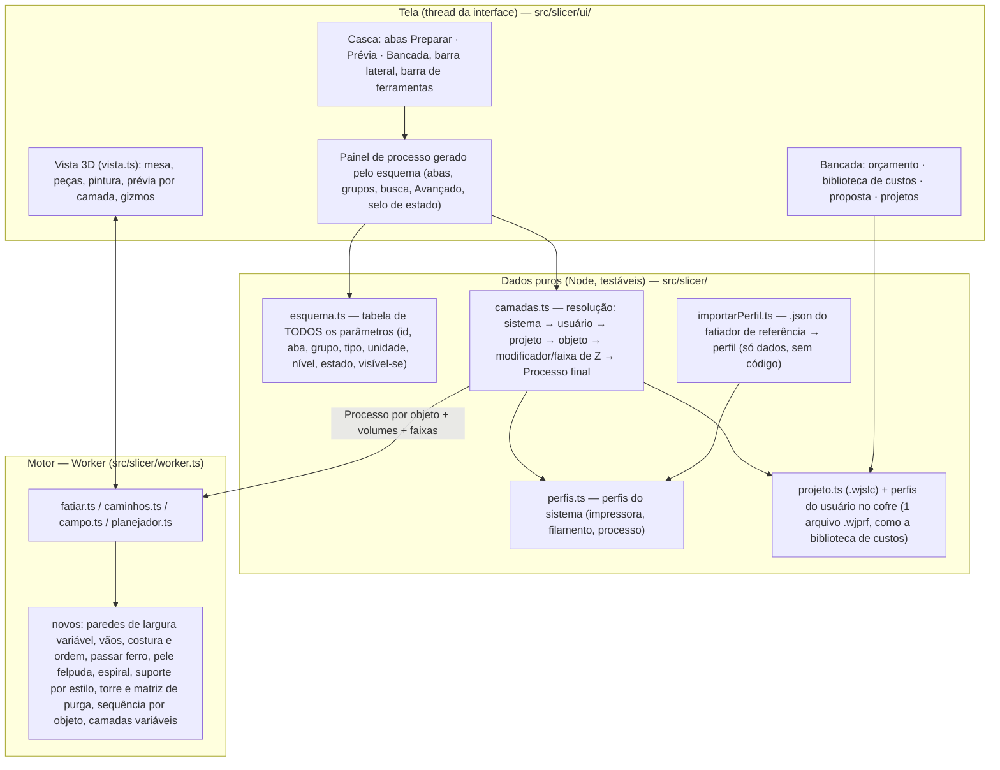

# WJSlicer3D — novo layout de fatiador completo (L-série)

> Pedido do Johann em 26/11/2026 (prints do fatiador que ele usa hoje: telas de impressora, filamento e
> processo, lista de perfis e barra de ferramentas): **o WJSlicer3D com este layout e com todas as funções
> destas abas.** Documento da central; cada conversa de código lê só a sua fatia (§6).
> Regras que valem: inspiração **só de função** (nada de código, ícone, texto ou nome de terceiros na
> UI; o fatiador de referência é AGPL — estudar a função, nunca copiar), tudo em português, tablet
> primeiro (alvos ≥ 44 px, caneta pinta e dedo navega), motor testado em Node e tela no navegador.
> **Decisões do Johann de 26/11 já aplicadas (§7); ficam abertos só os itens 3, 5 e 6.**

## 1. O que existe hoje (base)

- Motor real próprio (`src/slicer/`): paredes, cascas, 7 padrões, suporte normal e árvore, borda, saia, planejador de
  movimento, cores, orçamento. A estrutura `Processo` (`perfis.ts`) já guarda **~100 parâmetros** por impressora.
- A **tela** mostra só ~10 deles (camada, paredes, topo, fundo, preenchimento, padrão, suporte, borda, saia): o motor sabe
  muito mais do que o usuário consegue mexer. O layout novo vai **expor o que já existe** e depois acrescentar o que falta.
- Telas soltas em cartões (Peças, Impressora e material, Ajustes, Cores, Trocas, Resultado) + botões de topo
  (Biblioteca de custos, Orçamento, Proposta, Salvar/Abrir projeto).

## 2. O layout (wireframe — nomes nossos, em português)

```
┌ Arquivo ▾  ☰  💾  ↶  ↷  Calibrar ▾ ────────────────────────────────────────────────┐
│ [Início]  [ Preparar ]  [ Prévia ]  [ Bancada ]                                      │
├──────────────────────────┬──────────────────────────────────────────────────────────┤
│ Impressora        ⚙      │                                                          │
│ [Kobra 3 · 0,4 mm   ▾] ✎ │                                                          │
│ Filamento   +  −  ⇄  ⚙   │                  VISTA 3D DA MESA                        │
│ ①[PLA ▾] ②[PLA ▾]        │        (peças, cópias, pintura, prévia por camada)       │
│ ③[PETG ▾] ④[— ▾]         │                                                          │
│ Processo  [Global|Objetos]│                                                          │
│ Avançado ◉  [perfil ▾] 💾 🔍│                                                          │
│ ↺ [0,20 mm Padrão     ▾]  │                                                          │
│ Qualidade·Resistência·   │                                                          │
│ Velocidade·Suporte·      │                                                          │
│ Multimaterial·Outros     │                                                          │
│ ┌ grupo: Costura ──────┐ │                                                          │
│ │ campo ........ valor │ │                                                          │
│ └──────────────────────┘ │                                                          │
├──────────────────────────┴──────────────────────────────────────────────────────────┤
│ ＋Obj ＋Mesa Auto-orientar Organizar Camadas │ Mover Girar Escala Apoiar Cortar │ ... │
└──────────────────────────────────────────────────────────────────────────────────────┘
```

Abas de topo: **Preparar** (mesa e ajustes), **Prévia** (camadas, tempo por tipo, material), **Bancada** (o que o
WJSlicer3D já tem de orçamento: biblioteca de custos, orçamento, proposta, projetos do cofre — não há
impressora conectada porque não há G-code; a aba da referência é de monitorar/enviar, a nossa é de *orçar e entregar*).
Barra lateral esquerda rolável, vista 3D à direita, **barra de ferramentas embaixo** (celular: ícones sem texto;
sidebar vira gaveta). Computador: sidebar 380 px; tablet: 360 px com alvos ≥ 44 px.

## 3. Inventário completo (o que cada aba e cada perfil tem)

Legenda da coluna **Estado**: ✅ já no motor · 🟡 motor tem parte · 🔶 precisa de algoritmo novo (fatia M/S) ·
⚪ não muda tempo nem material · ⛔ só existe por causa do G-code. **Decisão do Johann (26/11): ⚪ e ⛔ ficam
ESCONDIDOS na tela** (nem aparecem na busca); só entram no esquema como "oculto" para a importação de perfis
não perder o valor. Os demais campos mostram o estado (🟡/🔶 = "ainda não aplicado") em selo pequeno: nada finge funcionar.

### 3.1 Cabeçalho do painel

| Item | Função | Estado |
|---|---|---|
| **Impressora** | lista de perfis (sistema + usuário), editar (✎), ⚙ configurações da impressora (§3.8) | 🟡 só 2 máquinas fixas |
| **Filamento** (até 4 posições) | perfil por posição, + / − posição, **matriz de purga entre cores** (⇄), sincronizar, ⚙ filamento (§3.9) | 🟡 cor/material/R$/kg; sem matriz |
| **Processo** Global / Objetos | Global = perfil do projeto; Objetos = ajustes só do objeto/peça escolhida (§3.7) | 🔶 |
| **Avançado** (chave) | mostra o nível "avançado/especialista" de cada campo (3 níveis: simples, avançado, especialista) | 🔶 |
| **Perfil de processo** | lista: "Perfis do usuário" e "Perfis do sistema" (0,08 / 0,12 Alta qualidade / 0,12 / 0,16 AQ / 0,16 / 0,20 AQ / **0,20 Padrão** / 0,24 / 0,28), salvar, **marca de alterado ↺** (volta ao perfil), busca 🔍 de parâmetro | 🔶 hoje só "Padrão do perfil" |

### 3.2 Aba **Qualidade**

| Grupo | Campos | Estado |
|---|---|---|
| Altura da camada | altura da camada; altura da 1ª camada | ✅ |
| Largura da linha | padrão; 1ª camada; parede externa; parede interna; superfície de topo; preenchimento esparso; preenchimento sólido interno; suporte | ✅ |
| Costura | posição (mais próxima, alinhada, alinhada atrás, atrás, aleatória); costuras internas alternadas; vão da costura; **costura em rampa (escarfada)**: tipo (nenhuma / contorno / contorno e furos), altura inicial, comprimento, passos, laço inteiro; velocidade base por função; **velocidade de limpeza**; **limpar nos laços**; limpar antes da parede externa | ✅ (M2, 27/11) |
| Precisão | raio de fechamento de fresta; resolução; ajuste de arcos; compensação XY de furo; compensação XY de contorno; compensação de "pé de elefante"; parede precisa; furo → polifuro; modo de fatiamento (normal / par-ímpar / fechar furos) | 🟡 (compensações XY, pé de elefante, polifuro e fechar furos ✅ M3; normal = par-ímpar 🟡; resolução e fresta ✅ no campo; arcos e parede precisa 🔶) |
| Passar ferro | tipo (nenhum / só topo mais alto / todas as superfícies de topo / todo sólido); padrão; fluxo; espaçamento; recuo; velocidade; ângulo | ✅ (M3, 28/11) |
| Gerador de paredes | clássico / **largura variável**; ângulo de transição; filtro; nº de paredes na transição; largura mínima de parede; tamanho mínimo de detalhe | ✅ (M1, 27/11) |
| Paredes e pontes | **ordem das paredes** (interna/externa, externa/interna, interna/externa/interna); fluxo de ponte; pontes grossas; densidade de ponte; detectar sólido interno estreito; garantir espessura vertical de casca; paredes extras em balanço; inverter em camadas pares/ímpares e limite; **só uma parede no topo** e limite; só uma parede na 1ª camada; **evitar cruzar paredes** e desvio máximo; limite de perímetro pequeno | 🟡 (fluxo de ponte, uma parede no topo/1ª camada ✅ M1; ordem das paredes e evitar cruzar ✅ M2; resto 🔶) |
| Avançado | direção do preenchimento; direção da ponte; sobreposição preenchimento/parede ✅; densidade de superfície de topo e de fundo; alinhar direção do preenchimento ao modelo; âncora do preenchimento ✅ e âncora máxima ✅; limite mínimo de esparso ✅; combinar preenchimento (a cada N camadas) | 🟡 |

### 3.3 Aba **Resistência**

| Grupo | Campos | Estado |
|---|---|---|
| Paredes | nº de paredes ✅; parede extra alternada; detectar parede fina | 🟡 |
| Cascas de topo e fundo | camadas de topo ✅; espessura de topo ✅; padrão da superfície de topo; camadas de fundo ✅; espessura ✅; padrão da superfície de fundo; padrão do sólido interno | 🟡 (padrões de topo/fundo fixos) |
| Preenchimento esparso | densidade ✅; padrão (hoje 7: grade, linhas, cruzado, triângulos, cúbico, giroide, favo; **a acrescentar**: cúbico adaptativo, relâmpago, estrela, cubo octeto-trançado, cúbico de suporte, tri-hexágono, multilinha) | 🟡 7 de ~14 |
| Preenchimento de vãos | ligar/desligar; velocidade | ✅ (M1) |

### 3.4 Aba **Velocidade**

| Grupo | Campos | Estado |
|---|---|---|
| 1ª camada | velocidade; preenchimento da 1ª camada | ✅ |
| Outras camadas | parede externa; parede interna; perímetro pequeno e seu limite; esparso; sólido interno; topo; preenchimento de vãos; suporte; interface do suporte | ✅ (perímetro pequeno e vãos ✅ M1) |
| Balanços | desacelerar em balanço (liga); faixas 10–25 / 25–50 / 50–75 / 75–100 % / ponte | ✅ |
| Deslocamento | velocidade de deslocamento | ✅ |
| Aceleração | padrão; parede externa; interna; topo; esparso; 1ª camada; deslocamento; ponte; deslocamento da 1ª camada | ✅ |
| Jerk | padrão; parede externa; interna; preenchimento; topo; 1ª camada; deslocamento | ✅ |
| Suavizar a taxa de extrusão | ligar; taxa máxima; janela | 🔶 |

### 3.5 Aba **Suporte**

| Grupo | Campos | Estado |
|---|---|---|
| Suporte | ligar; tipo: normal (auto) / árvore (auto) / normal (manual) / árvore (manual); **estilo**: padrão, grade, justo, orgânico, árvore forte, árvore fina, árvore híbrida; ângulo-limite ✅; só na mesa ✅; remover balanços pequenos; só regiões críticas; garantir suporte de pontes longas | 🟡 (2 tipos ✅; estilos e manual 🔶) |
| Jangada | camadas; distância Z de contato; expansão; densidade e expansão da 1ª camada | 🔶 |
| Filamento do suporte | base; interface | ✅ (X1) |
| Avançado | densidade da 1ª camada; expansão da 1ª camada; distância Z topo ✅ e fundo; padrão da base (padrão, retilíneo, grade, favo, relâmpago, oco) ; espaçamento ✅; ângulo; camadas de interface topo ✅ e fundo ✅; padrão da interface; espaçamento da interface ✅; expansão do suporte normal; distância XY ✅; não apoiar pontes; altura de camada independente; paredes do suporte | 🟡 |
| Árvore | distância entre galhos ✅; Ø do galho ✅; ângulo do galho ✅; paredes ✅; árvore com preenchimento; largura da borda automática | 🟡 |
| **Pintar suporte** (ferramenta, §3.10) | reforçar / bloquear suporte tocando a peça | 🔶 |

### 3.6 Aba **Multimaterial** e **Outros**

**Multimaterial**

| Grupo | Campos | Estado |
|---|---|---|
| Torre de purga | ligar ✅; largura ✅; largura da borda ✅; posição automática ✅ ou X/Y ✅ (**arrastar na mesa** 🔶 T1); volume de purga ✅; purgar para dentro do preenchimento ✅ / dos objetos 🟡 (todas as peças até a O1) / do suporte ✅; ângulo de rotação ✅; espaçamento extra ✅; espaçamento das linhas de purga ✅; fluxo extra da purga ✅; distância máxima de ponte 🔶; ângulo do cone de estabilização 🔶; tipo de parede (reta ✅ / nervura 🔶) | 🟡 (X1, 27/11/2026; 🔶 = X2) |
| Filamento por função | filamento da parede; do sólido interno; do suporte/jangada; da interface do suporte | ✅ (X1; jangada ainda não existe) |
| Evitar vazamento | ligar; variação de temperatura; tempo de pré-aquecimento; passos | ⚪ oculto |
| Matriz de purga | volume purgado para cada par de cores (4 × 4), multiplicador | 🔶 (hoje: um valor só por troca) |
| Avançado | encaixe de feixes (intertravar peças de cores diferentes); camadas, largura, profundidade e orientação do encaixe; casca de interface; evitar cruzar parede ao trocar | 🔶 |

**Outros**

| Grupo | Campos | Estado |
|---|---|---|
| Saia | voltas ✅; distância ✅; altura; velocidade ✅; tipo (combinada / por objeto); filamento mínimo extrudado | 🟡 |
| Borda | tipo (auto / só externa / só interna / externa e interna / sem borda / pintada); largura ✅; vão ✅; **orelhas de borda** | 🟡 (hoje liga/desliga) |
| Modo especial | sequência de impressão (por camada / **por objeto**, com folga entre objetos); **vaso em espiral**; **pele felpuda** (desligada / contorno / contorno e furos / todas as paredes; espessura; distância entre pontos; tipo de ruído); vídeo time-lapse (oculto ⛔) | ✅ (M3, 28/11; time-lapse oculto) |
| Saída | reduzir retração no preenchimento; resolução do G-code; numerar linhas; excluir objetos; rotular objetos; formato do nome do arquivo; scripts de pós-processamento; comentários | ⛔ **oculto** (sem G-code) |
| Observações | texto livre do perfil | ✅ (guardado no perfil) |

### 3.7 Aba **Objetos** (processo por objeto)

Lista (árvore) de objetos da mesa com: **ajustes só deste objeto** (qualquer campo do esquema, destacado quando diferente do
global); **partes** (adicionar parte, **parte negativa**, **modificador** de volume com ajustes próprios, **bloqueador** e
**reforço de suporte**); **faixa de altura** (ajustes por intervalo de Z; ex.: mais paredes só nos 5 primeiros mm);
**altura de camada variável** (suavizar automático e pintar à mão); renomear; remover; filamento do objeto.
Estado: 🔶 (o motor fatia uma peça por vez com um só `Processo`; passa a receber `Processo` + lista de sobreposições por
objeto/volume/faixa de Z).

### 3.8 ⚙ Configurações da impressora (por perfil de impressora)

Geral (área de impressão, áreas proibidas, altura máxima, **diâmetro do bico** fixo em 0,4) · Movimento
(velocidade, aceleração e jerk máximos de cada eixo, limites do Klipper/firmware) · Extrusor (retração, velocidade, levantar Z,
tipo de levantamento, limpeza, retração ao trocar de camada, só retrai acima de) · Multimaterial (trocas, purga de fábrica
de cada impressora) · Preparo (tempo típico) · Observações. (G-code de início/fim/troca: oculto.)
Só P1S e Kobra 3, **só bico 0,4 mm** (decisão do Johann, 26/11): o diâmetro do bico aparece, mas fixo.

### 3.9 ⚙ Configurações do filamento (por perfil de filamento)

Filamento (cor, **diâmetro**, densidade ✅, custo ✅, razão de fluxo ✅, vazão volumétrica máxima ✅) · Resfriamento (só o que
muda o tempo: **desacelerar para resfriar**, tempo mínimo de camada ✅ e limite de tempo de camada) · Substituições (retração,
levantar Z etc. por filamento 🟡) · Multimaterial (carga/descarga, "ramming", troca 🔶) · Dependências (impressoras compatíveis) ·
Observações. Ocultos (⚪/⛔): temperaturas, avanço de pressão, ventoinhas, encolhimento, G-code do filamento.
Materiais de fábrica de hoje: PLA, PLA alta velocidade, PETG, ABS, ASA, TPU (+ PA, PC, PVA, HIPS a acrescentar).

### 3.10 Barra de ferramentas (embaixo; ícones SVG próprios — leitura dos ícones das imagens a confirmar)

| Ferramenta | Função no WJSlicer3D | Estado |
|---|---|---|
| ＋ Objeto | adicionar STL (cofre, aparelho, WJCAD) | ✅ |
| ＋ Mesa | **várias mesas** (cada uma fatia e orça à parte; "unidades por mesa" do orçamento passa a vir daqui) | 🔶 |
| Auto-orientar | achar a melhor orientação (menos suporte / maior apoio) | 🟡 ("Melhor apoio") |
| Organizar | arrumar peças na mesa (fileiras hoje; **empacotamento 2D** depois) | 🟡 |
| Camadas variáveis | altura de camada variável (automática e pintada) | 🔶 |
| Mover / Girar / Escala | com **campos numéricos** (X, Y, Z, graus, %) e arraste na mesa; escala proporcional ou por eixo | 🟡 (giro por 90° hoje) |
| Apoiar na face | tocar uma face e colocá-la na mesa | 🟡 |
| Cortar | plano de corte (liso, com **pinos de encaixe**), manter as duas partes ou uma | 🔶 |
| Mesclar / Partes | unir ou separar partes do objeto (desativados quando não há seleção, como na referência) | 🔶 |
| Pintar cor | pincel, balde, ângulo, corpo (já existe) | ✅ |
| Texto em relevo | texto 3D sobre a peça ou separado (fonte, altura, profundidade) | 🔶 (precisa de contorno de fonte) |
| Pintar suporte | reforçar / bloquear | 🔶 |
| Pintar costura | indicar onde a costura fica / evitar | 🔶 |
| Pintar pele felpuda | região com pele felpuda | 🔶 |
| Copiar / Colar | (desativados sem seleção) | 🔶 |
| Medir | distância, ângulo, **medir entre faces** | 🔶 |
| Montar (vista de montagem) | explodir objetos de várias partes | 🔶 (fim da fila) |

### 3.11 Menu superior

Arquivo (novo projeto, abrir/salvar projeto `.wjslc`, **importar perfis** `.json` do fatiador de referência — formato aberto, só
dados —, **exportar perfis**, importar STL/3MF/OBJ(a confirmar), **exportar STL da mesa**), Editar (desfazer/refazer, copiar/colar),
**Calibrar** (hoje: "Calibrar tempo…"; as calibrações de impressão — torre de temperatura, fluxo, avanço de pressão — geram G-code
⛔ e ficam fora).

## 4. Arquitetura



Princípios:
1. **O esquema manda** (`esquema.ts`): a tela do processo é **gerada** dele (uma função de desenho só para os 6 painéis); campo novo =
   uma linha na tabela, com rótulo, unidade, limites, nível (simples/avançado/especialista), estado (✅🟡🔶⚪⛔) e "visível se". Busca,
   Avançado, selo de alterado e tooltips saem de graça. Teste em Node: todo campo do `Processo` aparece no esquema e vice-versa.
2. **Perfis em camadas e só diferenças**: sistema (fábrica, só leitura) → usuário (nome, "herda de", só as diferenças) → projeto →
   objeto → modificador/faixa de Z. `resolver()` é função pura; o ↺ do painel é a diferença contra o perfil; o projeto `.wjslc` guarda as
   diferenças (migra as preferências de hoje sem perder nada). Perfis do usuário num arquivo do cofre (igual em todos os aparelhos).
3. **Motor continua no Worker e sem dependência nova**; cada recurso novo do motor nasce atrás de um parâmetro do esquema com o padrão = o
   comportamento de hoje (**nenhum teste existente muda** sem decisão registrada).
4. **Precisão medida**: cada fatia de motor traz teste com cubo/cilindro/balanço e, quando o Johann mandar os valores de referência,
   exige ±5 %. Sem medida, o teste confere a geometria (comprimento de caminho, volume, contagem de trocas), não o tempo.
5. **Tela sem travar** (tarefas longas < 200 ms; o roteiro do tablet já mede isso) e **alvos ≥ 44 px**; painel com 150+ campos usa grupos
   recolhíveis e desenha só a aba aberta.
6. **Nada de G-code** (decisão do Johann, 08/11, 15/11 e 26/11): campos que só existem para G-code ficam **escondidos** (guardados só para a importação/exportação de perfis não perder valor).

## 5. Ordem e dependências

```
L0 esquema+perfis ─► L1a casca ✅ ─► L1b painel gerado ─► L2 Qualidade/Resistência (✅🟡) ─► L3 Velocidade/Outros (✅🟡)
                                   └──► L4 Impressora/Filamento ⚙ + importar perfil
Motor (depois de L1, uma por vez no mesmo arquivo):  M1 paredes ✅ ─► M2 costura/ordem ✅ ─► M3 acabamentos ✅ ─► M4 padrões
                                                     S1 suporte estilos ─► S2 suporte manual/jangada
                                                     X1 multimaterial ─► X2 matriz de purga e encaixe
Objetos:  O1 por objeto/partes ─► O2 faixas e camadas variáveis
Ferramentas:  T1 mover/girar/escala/apoiar/orientar ─► T2 cortar/medir ─► T3 mesas e empacotar ─► T4 pintar suporte/costura/felpuda ─► T5 texto ─► T6 montar
```
`caminhos.ts`, `campo.ts` e `main.ts` são tocados por muitas fatias: **uma de cada vez** (regra da central). Fatias de tela
(L1–L4) e de ferramentas não cruzam com as de motor se separarem os arquivos (`ui/*`).

## 6. Fatias (cada uma cabe em ~200 mil tokens; Sonnet por padrão, Opus só onde marcado)

| # | Fatia | Modelo | Entrega | Pronto quando |
|---|---|---|---|---|
| **L0 ✅** (26/11/2026) | Esquema de parâmetros + perfis em camadas + migração das preferências | Sonnet | `esquema.ts`, `camadas.ts`, perfis de sistema dos 9 processos de camada, `.wjprf` no cofre | Node: todo campo de `Processo` no esquema; resolver camadas; projeto antigo abre igual; cubo/cilindro com tempo **idêntico** ao de hoje |
| **L1a ✅** (27/11/2026) | Casca nova: abas Início/Preparar/Prévia/Bancada, barra lateral Impressora/Filamento/Processo (perfis do sistema e do usuário, selo ↺), barra de ferramentas, desfazer/refazer da pintura; as 6 abas do Processo com **só os campos de hoje** | Sonnet | página `slicer/` com o layout; cartões antigos migrados; Bancada = orçamento/biblioteca/proposta/projetos dentro da aba | roteiros do tablet 1280×800 (`roteiro-slicer*.cjs`, `roteiro-orcamento.cjs` adaptados + `roteiro-slicer-layout.cjs` com celular 390×844 e computador 1440×900) |
| **L1b** | **Painel gerado do esquema** (`esquema.ts`): os 6 painéis completos (grupos recolhíveis, selos de estado ✅🟡🔶), **busca 🔍**, chave **Avançado** (3 níveis), ↺ por campo do esquema, ⚙ de Impressora/Filamento ainda de fora (L3) | Sonnet | substitui os campos fixos da L1a; "chega na próxima etapa" some | teste em Node: todo campo visível do esquema aparece; roteiro do tablet por aba |
| **L2** | Velocidade, Suporte e Outros ligados ao que já existe (busca, Avançado e ↺ já vêm da L1b; salvar/renomear/excluir perfil do usuário e presets 0,08–0,28 já entregues na L1a) | Sonnet | seis abas completas com selos de estado | todo campo ✅ muda o resultado (teste por campo); salvar e reabrir perfil |
| **L3** | ⚙ Impressora e ⚙ Filamento (bico fixo 0,4; novos materiais; diâmetro; resfriamento) + **importar/exportar perfis** do fatiador de referência (`.json`) | Sonnet | diálogos de impressora/filamento; importação com relatório "usado / guardado / ignorado" | perfil real do Johann ("Calibrado Letras") importado sem erro; relatório confere |
| **M1 ✅** (27/11/2026) | Paredes de **largura variável** + preenchimento de vãos + **uma parede no topo** + perímetros pequenos | **Opus** | `paredes.ts` (novo) + `caminhos.ts` | Node (`teste-paredes.ts`): padrões idênticos; placa 0,9 mm, cunha, anel fino cobertos ~97–99 % sem sobreposição; ±5 % quando houver referência (ainda vazia: conferido só geometricamente) |
| **M2 ✅** (27/11/2026) | **Costura** (posição, alinhada, escarfada), **ordem das paredes**, evitar cruzar, limpar nos laços | **Opus** | `costura.ts` (novo) + `caminhos.ts`, `fatiar.ts` | Node (`teste-costura.ts`): padrões idênticos; costura alinhada em cubo/cilindro; ordem muda o tempo (material das paredes igual); desvio na peça em U; sem NaN |
| **M3 ✅** (28/11/2026) | Acabamentos: passar ferro, pele felpuda, vaso em espiral, pé de elefante, compensação XY, polifuro, modo de fatiamento, sequência por objeto | Opus | `acabamentos.ts` (novo) + `caminhos.ts`, `fatiar.ts` | Node (`teste-acabamentos.ts`): padrões idênticos; ferro = área × camada × fluxo; pele dentro da faixa; vaso sem paradas de camada; pé de elefante/compensação pelo perímetro; polifuro de 24 lados no anel Ø12; fechar furos = disco; por objeto = mesmo material, menos deslocamento |
| **M4** | Padrões que faltam (cúbico adaptativo, relâmpago, estrela, octeto, multilinha…), padrões de topo/fundo, combinar preenchimento, suavizar extrusão | Sonnet | `caminhos.ts` | densidade 20 % por padrão (como hoje) |
| **S1** | Suporte: estilos (grade, justo, orgânico, árvore forte/fina/híbrida), jangada, regiões críticas | **Opus** | `caminhos.ts` | Node: balanço e ponte longa por estilo |
| **S2** | Suporte manual: reforço e bloqueador pintados + ferramenta | Sonnet | `cores.ts`-like, vista | roteiro com caneta (CDP) |
| **X1 ✅** (27/11/2026) | Multimaterial: filamento por função, torre completa e arrastável, purgar no preenchimento/objetos/suporte (motor e dados; arrastar e tela ficam para L1b/T1) | **Opus** | `fatiar.ts`, `cores.ts` | Node: trocas; torre cabe na mesa |
| **X2** | **Matriz de purga** por par de cores, encaixe de feixes, evitar vazamento | Sonnet | `orcamento`-ligado | Node: custo por par |
| **O1** | Aba **Objetos**: ajustes por objeto, partes, parte negativa, modificadores de volume | **Opus** | `camadas.ts`, `fatiar.ts`, worker | Node: objeto com 5 paredes e outro com 2 |
| **O2** | Faixas de altura e **camada variável** (automática e pintada) | **Opus** | `caminhos.ts` | Node: faixa de Z; camadas de alturas diferentes |
| **T1** | Mover/Girar/Escala numéricos + gizmo, apoiar na face, auto-orientar melhor, desfazer da mesa | Sonnet | `ui/ferramentas.ts`, `vista.ts` | roteiro tablet |
| **T2** | Cortar (com pinos) e Medir | Sonnet | `malha.ts` | Node: corte fecha as malhas |
| **T3** | Várias mesas + empacotamento 2D | Sonnet | `fatiar.ts`, `orcamento.ts` | Node: mesas independentes; orçamento por mesa |
| **T4** | Pintar costura / felpuda | Sonnet | `cores.ts` | roteiro caneta |
| **T5** | Texto em relevo | Sonnet | novo | Node: sólido fechado |
| **T6** | Montar (explodir partes) | Sonnet | `vista.ts` | roteiro |

Ordem sugerida das primeiras: **L0 → L1** (uma de cada vez; base de tudo) → **L2** → **L3** em paralelo com **M1** (arquivos
diferentes) → M2 → S1/X1 …  Cada conversa faz push e resumo de passagem a ~180 mil tokens (regra de 26/11).

## 7. Decisões

Respondidas pelo Johann em 26/11/2026:
1. **G-code**: segue **sem G-code**; campos que só existem por causa dele ficam **escondidos** (⚪/⛔).
2. **Bancada** = orçamento + biblioteca de custos + proposta + projetos do cofre.
3. **Impressoras**: só P1S e Kobra 3, **só bico 0,4 mm**.

Abertas:
4. **Importar perfis**: ler o `.json` exportado do fatiador dele (formato aberto, só dados) para trazer **"Calibrado Letras"** e os
   outros sem digitar. Preciso dos arquivos (Arquivo → Exportar → perfis de impressora, filamento e processo) antes da L3.
5. **Valores de referência** (já pendentes): cubo 20 mm e cilindro Ø20×20 na P1S e no Kobra 3, peça com balanço na P1S (tempo e
   gramas), e uma impressão multicolorida medida. Sem eles M1–M2 ficam só com teste geométrico.
6. Leitura dos ícones da barra (§3.10): confirmar se bate com o que ele usa.
